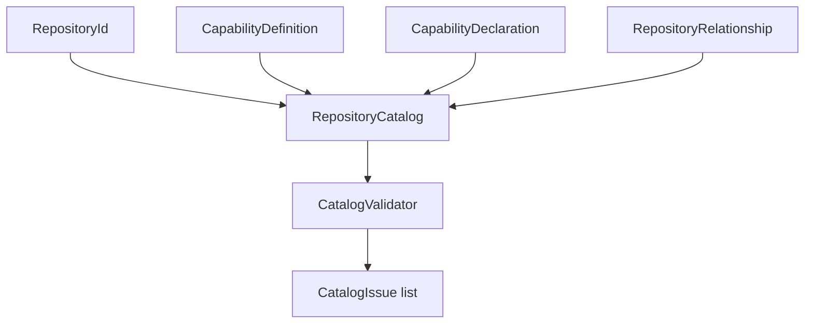

# CiAi.CogA Gallery

CogA's first living slice is the **typed repository catalog**: identities, capability declarations, and directed relationship edges are represented as explicit .NET objects and checked by deterministic offline rules.

## Model at a glance

This diagram describes the implemented model shape; it is not a live network topology or evidence of successful dispatch.

## Run and explore

- [Offline catalog sample](samples/CiAi.CogA.Sample/Program.cs) — construct and validate a sample topology.
- [Offline catalog recipe](docs/recipes/offline-catalog.md) — run the sample and adversarial checks.
- [UML class model](docs/UML/RepositoryCatalogUML.md) — inspect model types, directionality, and use cases.
- [Integration proposal](docs/INTEGRATION.md) — contract questions for CiAi reconciliation.

## Current limits

No GitHub ingestion, transport, workflow dispatch, credential handling, persistence format, ProtocolAi integration, or GUI projection is implemented. Read [readiness and evidence](docs/READINESS.md) before treating this slice as an integration contract.
