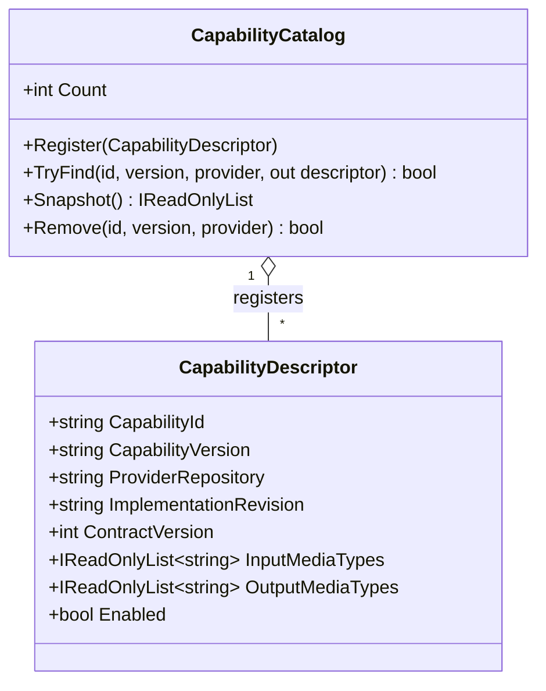

# CapabilityCatalog UML and Use Case

**Owner moniker:** The Singularity Workshop  
**Purpose:** register, inspect, and remove explicit versioned capability declarations without granting execution permission.

## Class diagram

## Use case: resolve an eligible capability declaration

1. Coordinator registers a descriptor from an explicitly trusted declaration source.
2. Coordinator requests an exact capability ID, version, and provider identity.
3. CogA returns the descriptor only if that exact tuple exists.
4. Coordinator separately asks CogD to evaluate authorization before creating work.
5. If a declaration is removed, previously issued request identities remain historical facts; removal does not rewrite them.

## Explicit non-goals

- No implicit repository crawling or network access.
- No authorization decision.
- No request dispatch, result validation, or execution.
- No claim that a declared provider is healthy or trustworthy merely because it is cataloged.
