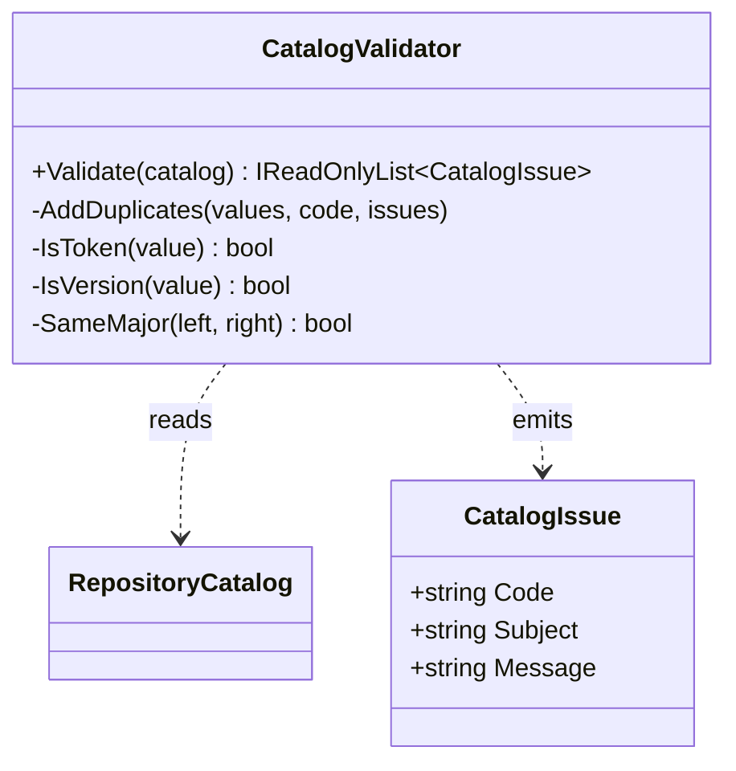

# CatalogValidator — UML

## Use cases

- Validate an offline catalog before it is offered to a consumer.
- Detect duplicate identities, unknown references, malformed versions, incompatible major versions, and invalid edge endpoints.
- Return stable issue codes for automated tests and future presentation.
- Reject invalid structure without invoking a remote service or executing an operation.

This is source-derived documentation for the current implementation; it does not claim validation of remote GitHub state or live CI evidence.
