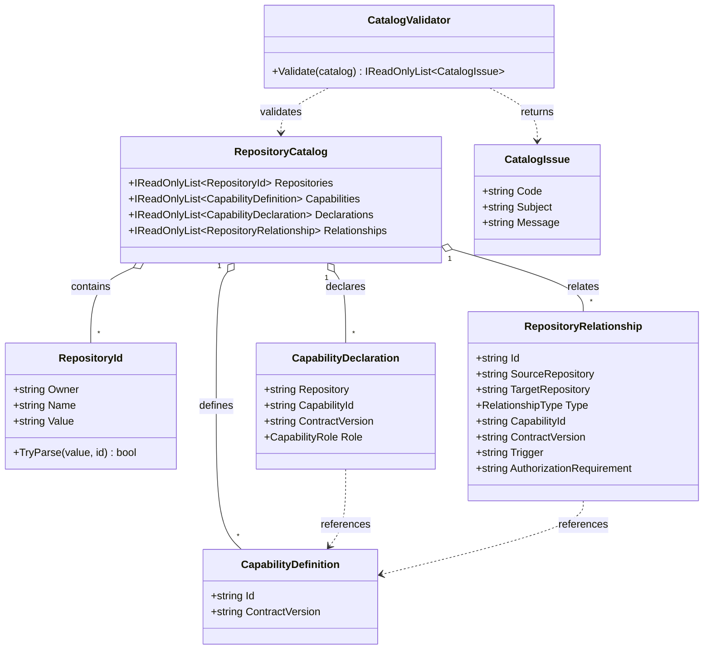

# RepositoryCatalog — UML

This diagram is derived from the current CogA source types. It models declarations and catalog structure, not runtime connectivity.

## Use cases

- **Build a catalog:** provide known repository identities, capability vocabulary, declarations, and directed relationships.
- **Validate before integration:** run `CatalogValidator.Validate` and inspect stable issue codes.
- **Explain topology:** future consumers can project the same model into text or a GUI without treating declarations as permissions.
- **Reconcile vocabulary:** send contract proposals to CiAi/ProtocolAi owners before using this experimental vocabulary as a shared wire contract.

## Important distinction

A valid edge is a structurally valid claim. It is not proof of dispatch, authorization, a successful workflow, or current repository state.
