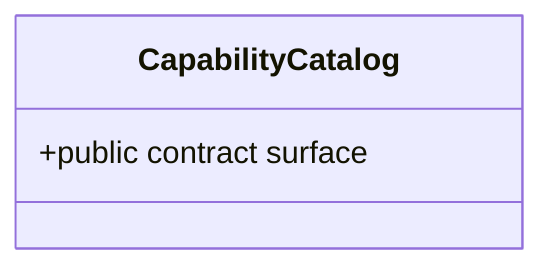

# CapabilityCatalog

**Owner moniker:** The Singularity Workshop  
**Purpose:** catalog capability declarations by provider, capability ID, version, implementation revision, contract, and media types.

## Responsibility

Catalog capability declarations by provider, capability ID, version, implementation revision, contract, and media types. The class provides a bounded, dependency-free control-plane primitive. It does not perform remote execution, grant implicit permission, or replace authoritative provider evidence.

## UML class card

For the focused class diagram and use case, see [CapabilityCatalog UML](../../docs/UML/CapabilityCatalogUML.md).
